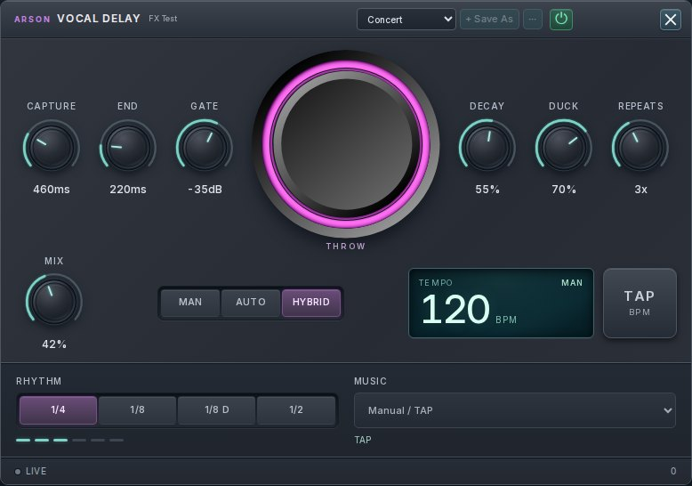
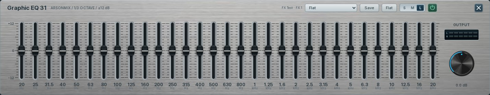
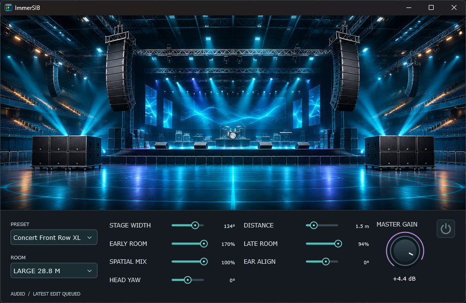
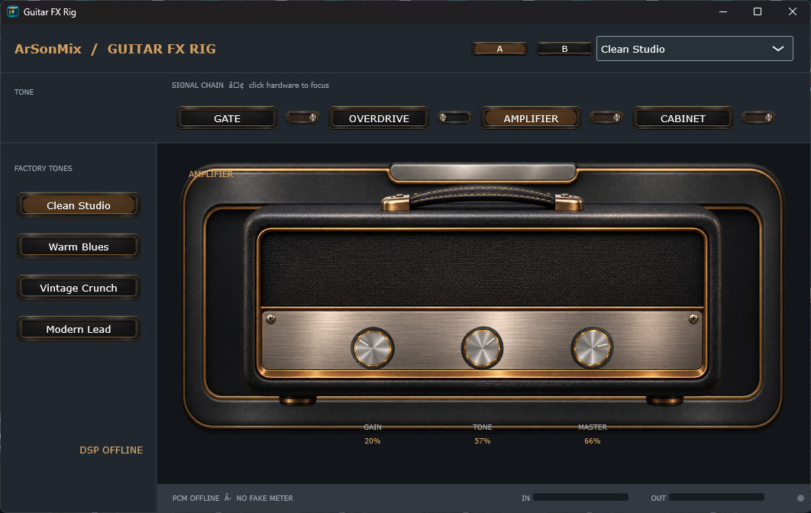

  

<h1 align="center">ArSonMix</h1>

<strong>Your live mix, under your control.</strong> A lightweight, free, open-source digital mixing studio for live vocals, karaoke, streaming and instruments.

  <a href="https://masarray.github.io/arsonmix/#download"><strong>Download ArSonMix</strong></a> ·
  <a href="https://masarray.github.io/arsonmix/#system-requirements">System requirements</a> ·
  <a href="https://masarray.github.io/arsonmix/preview/">Explore the mixer</a> ·
  <a href="https://masarray.github.io/arsonmix/#effects">Built-in effects</a> ·
  <a href="https://masarray.github.io/arsonmix/#feedback">Share feedback</a> ·
  <a href="CHANGELOG.md">Changelog</a>

Owner-provided ArSonMix Windows mixer screenshot (visible application version v0.5.0-alpha.31; audio device unavailable at capture). The download page lists the separately verified current installer.

## Your mix, your sound

Bring your voice, instruments and music together in a single live digital mixer. Shape your sound, connect channels with **WIRE**, add your favorite effects and save the entire setup as a `.smix` session. Great for karaoke, streaming, live vocals and home studios.

**Get started on Windows 10/11 (64-bit).** **[Download ArSonMix](https://masarray.github.io/arsonmix/#download)** or [explore the mixer online](https://masarray.github.io/arsonmix/preview/). Free to download, no sign-up required. The download page points to the latest published installer; the [release history and checksums](https://github.com/masarray/arsonmix/releases) also provide portable packages and previous releases for rollback.

## See the mixer in action

| WIRE routing and input gain | Channel levels and faders |
|:--:|:--:|
|  |  |

## Built-in audio effects — one tool at a time

ArSonMix is a **free, open-source digital mixer for Windows** with visual WIRE signal routing, live channel controls and built-in vocal, spatial, tone and guitar effects. Each audio effect has its own explanatory page with actual editor visuals.

| Built-in FX | What it does | Explore |
| --- | --- | --- |
| **8D-SonKu P9.9** | Headphone-oriented 8D spatial audio: binaural positioning, movement and a visible orbit map. | [8D audio guide](https://masarray.github.io/arsonmix/effects/8d-sonku/) |
| **Vocal Delay** | Phrase-aware vocal echoes and creative delay throws using timing and THROW controls. | [Vocal Delay guide](https://masarray.github.io/arsonmix/effects/vocal-delay/) |
| **Harmonice** | Musical-key-aware harmony and doubling tools for fuller live vocals. | [Harmonice guide](https://masarray.github.io/arsonmix/effects/harmonice/) |
| **Parametric EQ** | Shape individual channel frequencies while viewing the filter response curve. | [Parametric EQ guide](https://masarray.github.io/arsonmix/effects/channel-eq/) |
| **Compressor** | Shape dynamic levels using the built-in transfer-curve and compression editor. | [Compressor guide](https://masarray.github.io/arsonmix/effects/compressor/) |
| **Graphic EQ 31** | Fine-tune tone across thirty-one labeled bands in a hardware-style equalizer. | [Graphic EQ 31 guide](https://masarray.github.io/arsonmix/effects/graphic-eq31/) |
| **ImmerSIB** | Explore concert halls, arenas and theater listening scenes with stage and room controls. | [Six native venue screenshots](https://masarray.github.io/arsonmix/effects/immersib/) |
| **Guitar FX Rig** | Explore gate, overdrive, amplifier and cabinet stages, plus guitar tone choices. | [Guitar FX guide](https://masarray.github.io/arsonmix/effects/guitar-fx/) |

Other console tools: **WIRE routing** connects signals visibly; **ArSon Player** keeps playback near the mixer; **.smix sessions** save your setup; **VST3 hosting** loads compatible external effects (external plug-ins retain their own licenses; the exact FactoryFX inventory, if included, is listed in each verified release).

### Original built-in effect editor interfaces

These six screenshots use the original approved JUCE WebView editor HTML/CSS/JS captured through a controlled Chromium test. They are not generated marketing mockups or evidence of live audio.

| 8D-SonKu | Vocal Delay |
|:--:|:--:|
|  |  |
| **Harmonice** | **Parametric EQ** |
|  |  |
| **Compressor** | **Graphic EQ 31** |
|  |  |

### Newer native Windows editor captures

ImmerSIB and Guitar FX Rig are shown **after** the original effects. To keep the main website light, it shows one ImmerSIB image; all six scene captures belong to the dedicated ImmerSIB page.

| ImmerSIB — Concert Front Row XL | Guitar FX Rig — Clean Studio |
|:--:|:--:|
|  |  |

These are genuine owner-supplied Windows editor screenshots, not a verified DSP/hardware test. The Guitar FX capture visibly reads **DSP OFFLINE**; the exact installed binary used for those screenshots was not independently identified.

[Explore the built-in FX showcase](https://masarray.github.io/arsonmix/#effects) or [try the official mixer preview](https://masarray.github.io/arsonmix/preview/). The preview is visual only; native audio and effects require a compatible desktop audio setup.

## System requirements (Windows)

A lightweight native mixer with a compact download. No dedicated GPU or SSD required. Even older PCs are worth trying with a simple mix.

Small download: the exact Windows installer ZIP size is shown on the download card. Installed files, temporary extraction, updates and WebView2 (if missing) need additional space.

| Component | Basic mixing (try on older PCs) | More effects / larger sessions |
| --- | --- | --- |
| CPU | Older 64-bit dual-core Intel or AMD CPU (try first) | Modern quad-core or better |
| RAM | 4 GB (try light sessions); 8 GB preferred | 8 GB or more; 16 GB helpful for streaming |
| Storage | HDD or SSD; space for download, extraction and installation | Extra space only as needed for recordings, plugins and projects |
| Graphics | Integrated graphics | Integrated graphics |
| Display | 1366 × 768 suggested | 1920 × 1080 or higher for more workspace |
| Operating system | Windows 10 (1809+) / 11 x64 | Windows 11 x64 |
| Runtime | Microsoft Edge WebView2 Runtime | Microsoft Edge WebView2 Runtime |
| Audio driver | Compatible WASAPI or ASIO | Native ASIO driver preferred |
| Audio setup | 48 kHz, 256–512 samples to start | 48 kHz, 128–256 samples if stable |

Start with karaoke, playback or a few vocal channels. Add EQ, compression and reverb as needed. More channels, Harmonice, ImmerSIB, external VST3 and video streaming can require more CPU and memory.

These are starting-point suggestions, not certified minimum specifications. Low-spec PCs have not yet been qualified across physical test machines. If audio crackles, try a larger buffer or fewer heavy effects. No guarantee of dropout-free audio on every PC.

[View system requirements on the download page](https://masarray.github.io/arsonmix/#system-requirements).

## From download to your first mix

1. **Get ArSonMix.** [Download the Windows installer ZIP](https://masarray.github.io/arsonmix/#download), extract it and run Setup.
2. **Set your sound card.** Choose your audio interface and output in Audio Setup. Start with a comfortable monitoring level.
3. **Mix and create.** Adjust a channel fader, add an effect, route it to MAIN and save your workspace as a `.smix` session.

Compatibility and release information

The Windows release is an early-access build for Windows 10/11 x64. A compatible audio driver and Windows WebView2 may be required. Features and device behavior depend on your setup; see [release notes](https://github.com/masarray/arsonmix/releases). Keep a backup of important `.smix` sessions before updating. Current audio routing uses one primary ASIO device; independently synchronized dual-vendor ASIO is not advertised as a released feature.

## Help shape the next ArSonMix

Tried a mix? We'd love to hear what you created, which FX you enjoyed and what would make the console even easier to use. Suggestions and bug reports both help prioritize the next release.

- [Report a reproducible problem](https://github.com/masarray/arsonmix/issues/new?template=01_bug_report.yml) — include the installed version, Windows/audio device and driver, sample rate/buffer if relevant, steps, what you expected, and what happened.
- [Suggest a feature or workflow improvement](https://github.com/masarray/arsonmix/issues/new?template=02_feature_request.yml) — explain the result you wanted, even if you don't know how to build it.
- [Browse community issues](https://github.com/masarray/arsonmix/issues) — check existing reports and follow progress.

You can download ArSonMix without a GitHub account. Posting an issue requires GitHub sign-in.

## Free and open source

ArSonMix is open-source software licensed under **AGPL-3.0-only** for its original mixer, GUI and native built-in effects. The app includes a dedicated **More > About & Licenses** section. [View the license](LICENSE), [third-party notices](LICENSE-NOTICE.txt) or [current releases](https://github.com/masarray/arsonmix/releases).

Third-party plugins and audio drivers retain their own license terms. See [copyright and authorship](COPYRIGHT.md), [official identity and download verification](TRADEMARK.md), and the [third-party inventory](docs/security/ZBSH-02_THIRD_PARTY_INVENTORY.md).

**Security:** please [report suspected vulnerabilities privately](SECURITY.md), not in ordinary public bug reports. Official downloads come from [GitHub Releases](https://github.com/masarray/arsonmix/releases); compare the exact asset SHA-256 with trusted release metadata.

<strong>For developers and contributors</strong>

Read [CONTRIBUTING.md](CONTRIBUTING.md), [AGENTS.md](AGENTS.md) and the [Smart CI workflow](docs/SMART_CI_RUNNER_WORKFLOW.md). Historical engineering regression references remain in [the archived GUI baseline](docs/GUI_BASELINE_LOCK_2026-10-25.md), [Smart Audio Engine ARD](docs/ARD_SMART_AUDIO_ENGINE_V1_2026-10-25.md) and [Implementation Blueprint](docs/SMART_AUDIO_ENGINE_IMPLEMENTATION_BLUEPRINT.md); these are not a list of presently released capabilities. Preserve one approved [`/preview/`](https://masarray.github.io/arsonmix/preview/) GUI, the native JUCE PCM/FX graph, accepted ChannelId/EdgeId graph state and native ACK/readback, and use exact-SHA validation. The Pages and Cloudflare pipeline share the same `site/` landing and compiled GUI; see [publishing](docs/GITHUB_PAGES_PREVIEW.md). Physical ASIO FAT is separate from Chromium and unit-test success. Hardware audio regression and physical crackle field evidence are tracked in [issue #15](https://github.com/masarray/arsonmix/issues/15). Current integration coordination: [INT-1 #837](https://github.com/masarray/arsonmix/issues/837).

