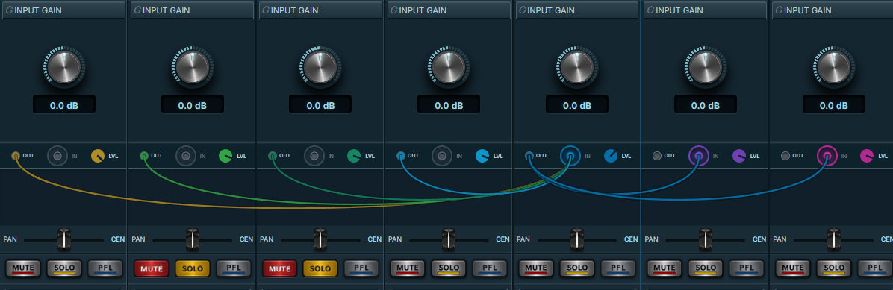
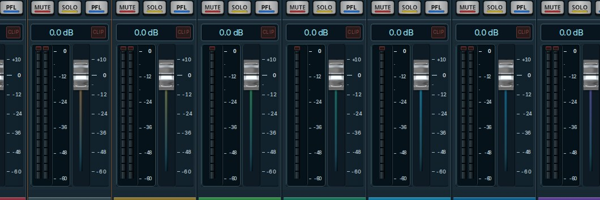

  

<h1 align="center">ArSonMix</h1>

<strong>Your live mix, under your control.</strong> A free, open-source digital mixing studio for live vocals, karaoke, streaming and instruments.

  <a href="https://masarray.github.io/arsonmix/#download"><strong>Download ArSonMix</strong></a> ·
  <a href="https://masarray.github.io/arsonmix/preview/">Explore the mixer</a> ·
  <a href="https://masarray.github.io/arsonmix/#effects">Built-in effects</a> ·
  <a href="https://masarray.github.io/arsonmix/#feedback">Share feedback</a>

Screenshot from the approved interactive mixer GUI. The browser preview is visual only; audio processing runs in the desktop application.

## Make your live sound yours

ArSonMix brings your microphone, music, interface and effects into one mixer. Adjust each channel, shape your sound, connect signals with **WIRE**, and save your workspace in a `.smix` session. It's a **live mixing console**, not a multitrack recording/timeline DAW.

**Windows 10/11 (x64) public alpha:** [Get the newest verified installer from the official downloads page](https://masarray.github.io/arsonmix/#download). You do **not** need a GitHub account to download. The official page selects the latest verified assets rather than a release version pinned in this README. [Browse published releases, checksums and release notes](https://github.com/masarray/arsonmix/releases).

## A closer look

| WIRE routing and FX | Channel levels and faders |
|:--:|:--:|
|  |  |

### What can you do?

| Feature | What it means for you |
| --- | --- |
| **Live mixer + WIRE** | Mix channels, manage levels, mute/solo, and route signals to MAIN or BUS. |
| **ImmerSIB** | Explore concert-inspired space and venue character with built-in listening scenes. |
| **8D-SonKu P9.9** | Add binaural movement and spatial perspective for headphone listening. |
| **Harmonice + Vocal Delay** | Shape vocal harmonies/doubling and phrase-aware delay in the mix. |
| **Guitar FX, EQ + Compressor** | Work with guitar tone, equalization and dynamics without leaving the console. |
| **ArSon Player + `.smix`** | Keep music close to the console and save or reopen mixer sessions. |
| **VST3 hosting** | Load supported external VST3 effects where compatible. Commercial plugins are not included. |

See the [built-in FX showcase](https://masarray.github.io/arsonmix/#effects) and [interactive mixer](https://masarray.github.io/arsonmix/preview/). The FX-rack images above are screenshots of the approved mixer GUI, **not screenshots of each native FX editor**. Some editors are available only in the Windows app.

## Start mixing in three steps

1. **Install.** On Windows 10/11 x64, [download the verified installer ZIP](https://masarray.github.io/arsonmix/#download), extract it, run Setup, and open ArSonMix. The latest published release determines the exact file and version. Windows WebView2 and a compatible audio driver may be required.
2. **Connect carefully.** In audio setup, select your actual audio device, driver and output pins. Start with speaker/headphone volume low; don't assume a disconnected or unassigned route will produce sound.
3. **Try a simple mix.** Add or select a channel, check its MAIN routing, adjust the fader, then insert an effect. Compare FX on/bypass at matched volume and save a `.smix` session.

**This is an actively developed alpha.** Native hardware audio, device recovery, external VST3 behavior and latency depend on your equipment and build. Save backups of valuable `.smix` sessions before upgrading. Single-primary-ASIO behavior is the current qualified architecture; multi-vendor dual-ASIO and unmerged GUI/Graphic EQ experiments must not be presented as shipped features. Browser preview interactions never certify physical audio performance.

## Help us make ArSonMix better

Real users and real devices help more than polished mockups. If you try ArSonMix, we'd especially appreciate feedback on installation, first sound, driver selection, FX usability, WIRE routing, session reopening and dropouts.

- [Report a reproducible problem](https://github.com/masarray/arsonmix/issues/new?template=01_bug_report.yml) — include the installed version, Windows/audio device and driver, sample rate/buffer if relevant, steps, what you expected, and what happened.
- [Suggest a feature or workflow improvement](https://github.com/masarray/arsonmix/issues/new?template=02_feature_request.yml) — explain the result you wanted, even if you don't know how to build it.
- [Browse community issues](https://github.com/masarray/arsonmix/issues) — check existing reports and follow progress.

Submitting an issue requires a GitHub account, but downloading ArSonMix doesn't. Please redact personal information, serial numbers and private file paths before sharing screenshots or logs.

## Open source, responsibly shipped

ArSonMix original mixer, routing, GUI and owned native built-in FX are licensed under **AGPL-3.0-only**. See [LICENSE](LICENSE) and [LICENSE-NOTICE.txt](LICENSE-NOTICE.txt). JUCE, VST3/ASIO SDKs, included data and separately installed plugins have their own terms; third-party commercial VST3 plugins are not bundled without permission. The Windows app exposes license notices under **More > About & Licenses**.

Each release provides source provenance and SHA-256 checksums. Installer/CI qualification is not a claim of independent hardware field testing on every interface. See [current releases](https://github.com/masarray/arsonmix/releases) and [official downloads](https://masarray.github.io/arsonmix/#download) for what is actually public.

<strong>For developers and contributors</strong>

Read [CONTRIBUTING.md](CONTRIBUTING.md), [AGENTS.md](AGENTS.md) and the [Smart CI workflow](docs/SMART_CI_RUNNER_WORKFLOW.md). Historical engineering regression references remain in [the archived GUI baseline](docs/GUI_BASELINE_LOCK_2026-10-25.md), [Smart Audio Engine ARD](docs/ARD_SMART_AUDIO_ENGINE_V1_2026-10-25.md) and [Implementation Blueprint](docs/SMART_AUDIO_ENGINE_IMPLEMENTATION_BLUEPRINT.md); these are not a list of presently released capabilities. Preserve one approved [`/preview/`](https://masarray.github.io/arsonmix/preview/) GUI, the native JUCE PCM/FX graph, accepted ChannelId/EdgeId graph state and native ACK/readback, and use exact-SHA validation. The Pages and Cloudflare pipeline share the same `site/` landing and compiled GUI; see [publishing](docs/GITHUB_PAGES_PREVIEW.md). Physical ASIO FAT is separate from Chromium and unit-test success. Current integration coordination: [INT-1 #837](https://github.com/masarray/arsonmix/issues/837).

