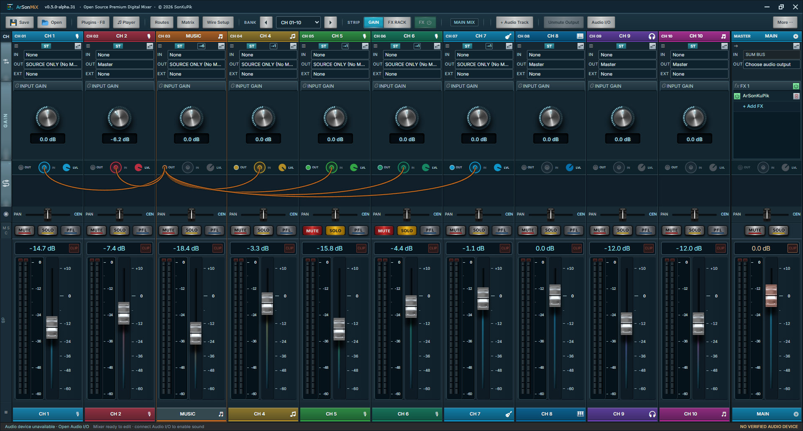
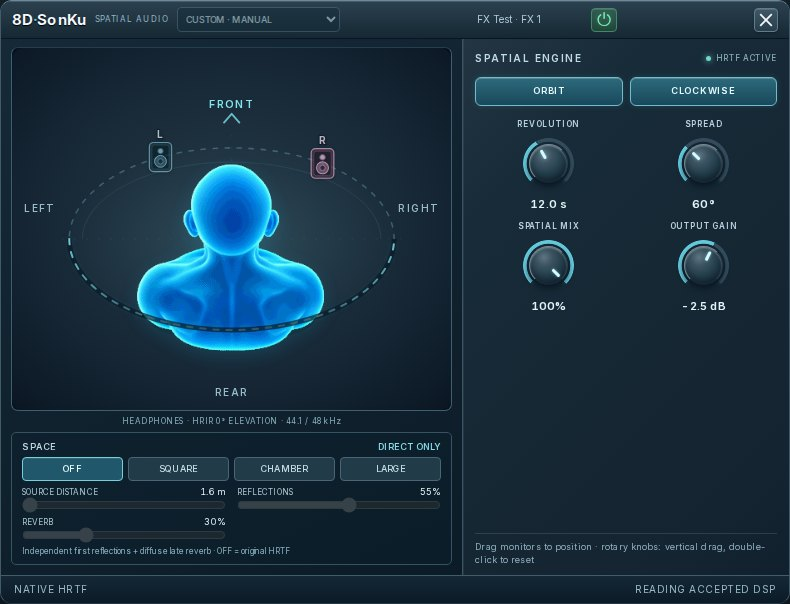
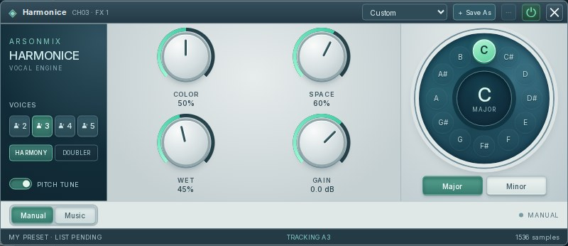
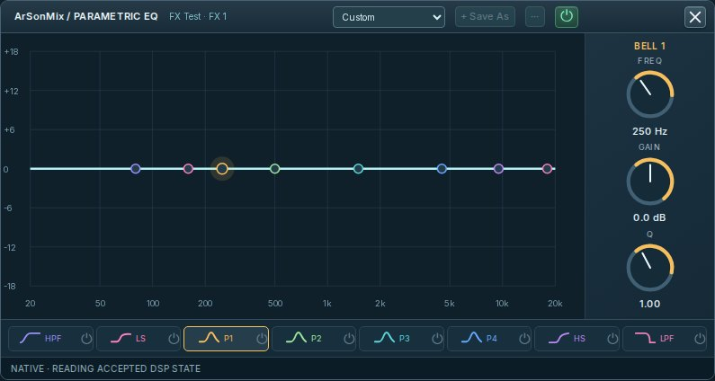
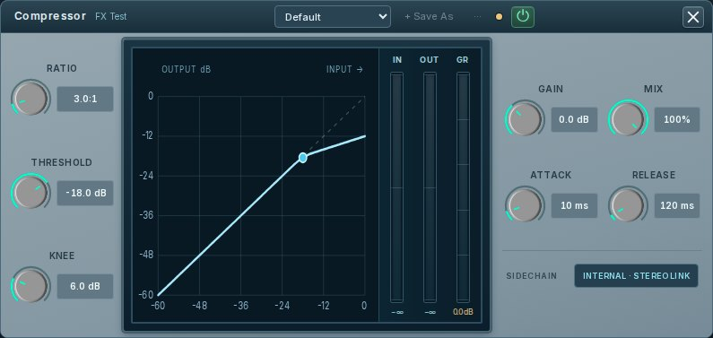

  

<h1 align="center">ArSonMix</h1>

<strong>Your live mix, under your control.</strong> A free, open-source digital mixing studio for live vocals, karaoke, streaming and instruments.

  <a href="https://masarray.github.io/arsonmix/#download"><strong>Download ArSonMix</strong></a> ·
  <a href="https://masarray.github.io/arsonmix/preview/">Explore the mixer</a> ·
  <a href="https://masarray.github.io/arsonmix/#effects">Built-in effects</a> ·
  <a href="https://masarray.github.io/arsonmix/#feedback">Share feedback</a>

The ArSonMix mixing console. Explore this interface online; run audio and built-in effects in the Windows desktop app.

## Your mix, your sound

Bring your voice, instruments and music together in a single live digital mixer. Shape your sound, connect channels with **WIRE**, add your favorite effects and save the entire setup as a `.smix` session. Great for karaoke, streaming, live vocals and home studios.

**Get started on Windows 10/11 (64-bit).** **[Download ArSonMix](https://masarray.github.io/arsonmix/#download)** or [explore the mixer online](https://masarray.github.io/arsonmix/preview/). Free to download, no sign-up required. The download page always points to the latest published installer.

## See the mixer in action

| WIRE routing and FX | Channel levels and faders |
|:--:|:--:|
|  |  |

## Sound-shaping tools built in

| Feature | What it means for you |
| --- | --- |
| **Live mixer + WIRE** | Mix channels, manage levels, mute/solo, and route signals to MAIN or BUS. |
| **ImmerSIB** | Explore concert-inspired space and venue character with built-in listening scenes. |
| **8D-SonKu P9.9** | Add binaural movement and spatial perspective for headphone listening. |
| **Harmonice + Vocal Delay** | Shape vocal harmonies/doubling and phrase-aware delay in the mix. |
| **Guitar FX, EQ + Compressor** | Work with guitar tone, equalization and dynamics without leaving the console. |
| **ArSon Player + `.smix`** | Keep music close to the console and save or reopen mixer sessions. |
| **VST3 hosting** | Load supported external VST3 effects where compatible. Commercial plugins are not included. |

### Inside the built-in FX

Click a screenshot to view the complete editor interface. These pictures come from ArSonMix's approved native WebView editor resources, not promotional mockups.

| 8D-SonKu | Vocal Delay |
|:--:|:--:|
|  |  |
| **Harmonice** | **Parametric EQ** |
|  |  |
| **Compressor** | **Graphic EQ 31** |
|  |  |

ImmerSIB and Guitar FX are also built-in effects; their dedicated native editor images will be added following a Windows capture.

Try the [built-in FX showcase](https://masarray.github.io/arsonmix/#effects) or [explore the console](https://masarray.github.io/arsonmix/preview/). The preview is visual only; native effect editors and audio run in the desktop app.

## From download to your first mix

1. **Get ArSonMix.** [Download the Windows installer ZIP](https://masarray.github.io/arsonmix/#download), extract it and run Setup.
2. **Set your sound card.** Choose your audio interface and output in Audio Setup. Start with a comfortable monitoring level.
3. **Mix and create.** Adjust a channel fader, add an effect, route it to MAIN and save your workspace as a `.smix` session.

Compatibility and release information

The Windows release is an early-access build for Windows 10/11 x64. A compatible audio driver and Windows WebView2 may be required. Features and device behavior depend on your setup; see [release notes](https://github.com/masarray/arsonmix/releases). Keep a backup of important `.smix` sessions before updating. Current audio routing uses one primary ASIO device; independently synchronized dual-vendor ASIO is not advertised as a released feature.

## Help shape the next ArSonMix

Tried a mix? We'd love to hear what you created, which FX you enjoyed and what would make the console even easier to use. Suggestions and bug reports both help prioritize the next release.

- [Report a reproducible problem](https://github.com/masarray/arsonmix/issues/new?template=01_bug_report.yml) — include the installed version, Windows/audio device and driver, sample rate/buffer if relevant, steps, what you expected, and what happened.
- [Suggest a feature or workflow improvement](https://github.com/masarray/arsonmix/issues/new?template=02_feature_request.yml) — explain the result you wanted, even if you don't know how to build it.
- [Browse community issues](https://github.com/masarray/arsonmix/issues) — check existing reports and follow progress.

You can download ArSonMix without a GitHub account. Posting an issue requires GitHub sign-in.

## Free and open source

ArSonMix is open-source software licensed under **AGPL-3.0-only** for its original mixer, GUI and native built-in effects. The app includes a dedicated **More > About & Licenses** section. [View the license](LICENSE), [third-party notices](LICENSE-NOTICE.txt) or [current releases](https://github.com/masarray/arsonmix/releases).

Third-party plugins and audio drivers retain their own license terms.

<strong>For developers and contributors</strong>

Read [CONTRIBUTING.md](CONTRIBUTING.md), [AGENTS.md](AGENTS.md) and the [Smart CI workflow](docs/SMART_CI_RUNNER_WORKFLOW.md). Historical engineering regression references remain in [the archived GUI baseline](docs/GUI_BASELINE_LOCK_2026-10-25.md), [Smart Audio Engine ARD](docs/ARD_SMART_AUDIO_ENGINE_V1_2026-10-25.md) and [Implementation Blueprint](docs/SMART_AUDIO_ENGINE_IMPLEMENTATION_BLUEPRINT.md); these are not a list of presently released capabilities. Preserve one approved [`/preview/`](https://masarray.github.io/arsonmix/preview/) GUI, the native JUCE PCM/FX graph, accepted ChannelId/EdgeId graph state and native ACK/readback, and use exact-SHA validation. The Pages and Cloudflare pipeline share the same `site/` landing and compiled GUI; see [publishing](docs/GITHUB_PAGES_PREVIEW.md). Physical ASIO FAT is separate from Chromium and unit-test success. Hardware audio regression and physical crackle field evidence are tracked in [issue #15](https://github.com/masarray/arsonmix/issues/15). Current integration coordination: [INT-1 #837](https://github.com/masarray/arsonmix/issues/837).

