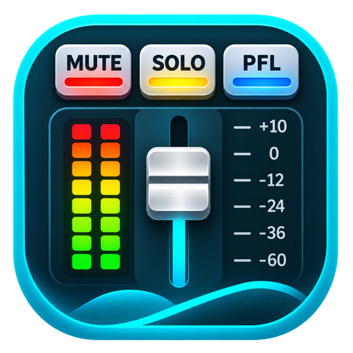

  

<strong>ArSonMix — Professional Live Mixing Studio</strong>

  <a href="https://masarray.github.io/arsonmix/">Website & downloads</a> ·
  <a href="https://masarray.github.io/arsonmix/preview/">Explore the mixer</a> ·
  <a href="https://github.com/masarray/arsonmix/releases">All releases</a> ·
  <a href="https://github.com/masarray/arsonmix/issues">Feedback</a>

# ArSonMix

**A native live digital mixer for singers, karaoke, streaming and live sound.** Route audio through channels and WIRE connections, work with FX and music, and keep your settings in a `.smix` session. ArSonMix is a live mixing console, **not** a timeline/recording DAW or a browser-based audio mixer.

## Download — current public preview

**Latest published release: [v0.5.0-alpha.9](https://github.com/masarray/arsonmix/releases/tag/v0.5.0-alpha.9), 10 November 2026.** It is an **alpha field-test build**, not a stable production release.

| System | Official package | Release |
| --- | --- | --- |
| **Windows 10/11 x64** | **[Download Setup EXE](https://github.com/masarray/arsonmix/releases/download/v0.5.0-alpha.9/ArSonMix-v0.5.0-alpha.9-Windows-x64-Setup.exe)** | **alpha.9 — current** |
| Windows x64, portable | [Download Portable ZIP](https://github.com/masarray/arsonmix/releases/download/v0.5.0-alpha.9/ArSonMix-v0.5.0-alpha.9-Windows-x64-Portable.zip) | alpha.9 |
| Linux x86_64 | [Download tar.gz](https://github.com/masarray/arsonmix/releases/download/v0.5.0-alpha.5/ArSonMix-v0.5.0-alpha.5-Linux-x86_64.tar.gz) | **alpha.5 — older build** |
| macOS universal | [Download DMG](https://github.com/masarray/arsonmix/releases/download/v0.5.0-alpha.5/ArSonMix-v0.5.0-alpha.5-macOS-universal.dmg) | **alpha.5 — older build** |

These are actual uploaded release assets, not CI-only artifacts. **Windows Setup EXE is the recommended one-click download**; the installer ZIP is a fallback. The [website download selector](https://masarray.github.io/arsonmix/#download) checks GitHub Releases and verified SHA-256/provenance metadata and chooses the newest *available package for each operating system*. A newer Windows-only release does not imply that Linux/macOS have been updated. Download and compare [alpha.9 SHA256SUMS.txt](https://github.com/masarray/arsonmix/releases/download/v0.5.0-alpha.9/SHA256SUMS.txt) before installation.

## What's in Windows alpha.9

- **Native logical mixer sessions:** add, rename and edit channels and buses, WIRE / SOURCE ONLY routing, and rack configuration even before an audio device is connected. The app preserves `.smix` Save/Open with native revision checks and durable readback. **Offline edit does not generate or certify live PCM.**
- **Live engine recovery:** a previously bound ASIO mixer can recover when the registered driver and playback pins are verified. Saved capture-patch choices are preserved if pins are missing; there is no claim that arbitrary hardware remapping is automatic.
- **Harmonice FX:** consistent plugin name in picker/editor and legacy session restore, an 8 ms bypass fade, and reacquisition of a Music guide after source loss. The released processing latency is still **32 ms**; experimental 24/16 ms work is *not* shipped.
- **ArSon Player:** relink missing songs through a completed folder scan using a unique *full filename*, retaining song identity, KEY and TEMPO.
- **Desktop workflow:** updated native titlebar and operator-facing status. The approved mixer UI is available as a read-only/simulated browser preview.

See the [alpha.9 release notes](https://github.com/masarray/arsonmix/releases/tag/v0.5.0-alpha.9) for detailed scope and test limitations. A green build is **not** proof of physical hardware performance.

## Get started

1. Install the Windows Setup EXE (or extract the portable ZIP), then start ArSonMix. A supported audio driver and Windows WebView2 runtime may be required.
2. Open the audio setup and choose the actual device/pins for listening. The mixer can be edited without hardware, but it can only output sound through a valid live audio device graph.
3. Use channel controls, FX and WIRE in the [approved console](https://masarray.github.io/arsonmix/preview/). Save/Open `.smix` sessions for your work. Start testing at safe headphone/speaker volume.
4. Report reproducible driver, WIRE, VST3, session or dropout problems in [GitHub Issues](https://github.com/masarray/arsonmix/issues), with device type, channel graph, sample rate, buffer size and steps.

### Field-test limitations

**Not yet certified for unattended or production-critical audio.** Physical ASIO/ASIO4ALL timing, real singer listening, vendor VST3 state, full device-loss behavior and uninterrupted performance still need hardware qualification. Initial hardware binding from a purely offline-created session and continued editing of a previously bound graph after unplugging are limited in alpha.9. If audio is disconnected, reconnect the verified device to resume its previously bound graph. Experimental Harmonice latency changes and Vocal Throw M15 remain outside this release.

Do not assume the older Linux/macOS alpha.5 builds contain Windows alpha.9 features.

## Preview vs real audio

**The one approved GUI:** [masarray.github.io/arsonmix/preview/](https://masarray.github.io/arsonmix/preview/). It is an interactive **visual preview only** — no browser hardware audio, no real native VST3 processing and no promise that a UI illustration is a supported sound route. Older preview URLs redirect here. The native Windows app uses the approved mixer renderer; changes must not introduce competing skins.

## Source, builds and contribution

The release tag **[v0.5.0-alpha.9](https://github.com/masarray/arsonmix/tree/v0.5.0-alpha.9)** is the authoritative source for that published binary. Development `main` and open draft PRs can have different feature/qualification status; **do not infer that every released alpha.9 change is already merged to `main`**, or that an unmerged experiment is released.

Contributors and development agents must read **[AGENTS.md](AGENTS.md)** and the **[Smart CI workflow](docs/SMART_CI_RUNNER_WORKFLOW.md)**, inspect live `main` plus open PRs, preserve one native JUCE PCM callback and native ChannelId/EdgeId authority, and qualify changes using selective exact-SHA tests. Hardware ASIO testing is separate from automated CI. Website deployment uses one `site/` landing and one assembled `/preview/` on GitHub Pages and Cloudflare Pages, with platform downloads resolved from verified GitHub Release assets. See [Pages publishing](docs/GITHUB_PAGES_PREVIEW.md) and [Cloudflare](docs/CLOUDFLARE_PAGES_BUILD.md).

Respect all source, SDK and VST3 plugin licenses. Third-party commercial VST3 plugins are not redistributed without authorization. Historical architecture and testing records remain in [docs/](docs/) (including the archived [GUI baseline](docs/GUI_BASELINE_LOCK_2026-10-25.md)), rather than being presented as current shipping features.
